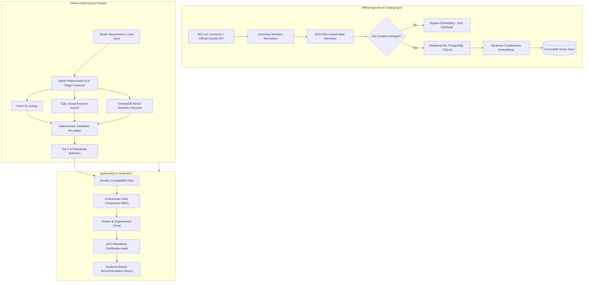

<div align="center">

# 🏛️ QueryNest AI: Bureau of Indian Standards (BIS) Procurement & Recommendation Engine

[](https://python.org)
[](https://fastapi.tiangolo.com)
[](https://react.dev)
[](https://vitejs.dev)
[](https://trychroma.com)
[](https://www.services.bis.gov.in)
[-brightgreen.svg)]()
[](LICENSE)

<p align="center">
  <strong>Next-Generation AI Knowledge Retrieval, Standardization, and Compliance Validation Engine for Indian Public Procurement</strong>
</p>

<p align="center">
  <em>Tailored for GeM (Government e-Marketplace), CPWD, State PWDs, Municipal Corporations, Defense, and Public Sector Undertakings (PSUs).</em>
</p>

<p align="center">
  <a href="#-system-overview">Overview</a> •
  <a href="#-key-features">Key Features</a> •
  <a href="#-architecture--pipeline">Architecture</a> •
  <a href="#-hybrid-retrieval-engine">Retrieval Engine</a> •
  <a href="#-applicability-matrix">Applicability Matrix</a> •
  <a href="#-catalog-scale--ingestion">Catalog Scale</a> •
  <a href="#-api-documentation">API Reference</a> •
  <a href="#-getting-started">Getting Started</a> •
  <a href="#-benchmarks">Benchmarks</a>
</p>

---

</div>

## 📌 System Overview

**QueryNest AI** is an enterprise-grade AI Knowledge Retrieval and Standards Validation platform engineered specifically for the Indian public procurement ecosystem. When government departments and commercial buyers procure technical equipment, construction materials, electrical infrastructure, or municipal utilities, specifying exact, active **Bureau of Indian Standards (BIS)** and enforcing mandatory **Quality Control Orders (QCO)** is legally mandatory under Indian procurement rules.

Manual identification of technical standards leads to obsolete citations, non-compliant tender documents, rejection of vendor proposals, and severe audit risks. **QueryNest AI** solves this by uniting **deterministic canonical standard normalization**, a **live 22,000+ BIS catalog sync**, a **hybrid multi-stage retrieval pipeline**, and an **evidence-based technical applicability matrix**.

### 🎯 Primary Use Cases
* **Public Tender Specification Formulation**: Automatically discover and attach applicable IS standards to tender criteria for GeM, CPWD, Railway, and State Utility bids.
* **Vendor Bid Compliance Validation**: Verify vendor equipment data sheets against mandatory standard clauses (conveyance pressure, insulation class, dielectric strength, tensile tolerance).
* **QCO & Statutory Certification Audits**: Instantly determine whether a product category requires mandatory ISI marking under Ministry Quality Control Orders.
* **Superseded & Withdrawn Standard Detection**: Prevent obsolete citations by detecting historical revisions and automatically substituting active successor standards.

---

## 🚀 Key Features

### 1. 🔍 Online Hybrid Retrieval Engine
* **Exact IS Pattern Matching**: Instant regex-boundary tokenization resolves explicit standard numbers (e.g., `IS 694`, `IS 4984`, `IS 7098 (Part 1):1988`) with zero semantic drift.
* **Weighted Full-Text Keyword Search**: Token-frequency scoring across standard titles, scopes, and technical requirements.
* **Semantic Vector Search**: Dense neural embeddings powered by `all-MiniLM-L6-v2` stored in ChromaDB for intent resolution on ambiguous natural-language specifications.
* **Deterministic Re-Ranking**: Unified score fusion dynamically blends exact, lexical, and semantic scores to return top candidate standards with zero hallucinations.

### 2. ⚡ Scaled 22,000+ Live BIS Catalog
* **Automated BIS Portal Connector**: Sweeps official BIS "Know Your Standards" registry across electrical, mechanical, civil, chemical, metallurgical, and textile directorates.
* **Canonical Standard Normalization**: De-duplicates and structures citations regardless of format variations (`IS 4984:2016`, `IS4984`, `IS 4984-2016`, `IS/ISO 9001`, `IS/IEC 60947`).
* **SHA-256 Incremental Ingestion**: Content hashing prevents redundant vector embeddings, ensuring zero overhead for unchanged records.

### 3. ⚖️ 6-Parameter Applicability Matrix
Evaluates technical suitability across six distinct engineering parameters:
1. **Material & Grade Compatibility** (e.g., PE 100 HDPE, Annealed Bare Copper, 53-Grade OPC)
2. **Operational Duty & Rating** (e.g., 1100 V working voltage, PN 10 pressure rating)
3. **Environmental & Thermal Limits** (e.g., -40°C to +70°C, FRLS insulation)
4. **Testing & Inspection Protocols** (e.g., Hydrostatic pressure test, spark testing)
5. **Quality Control Order (QCO) Mandate** (Scheme-I ISI Mark mandatory requirement check)
6. **Statutory Tender Criteria** (Government procurement safety notices and CPWD clauses)

### 4. 🔄 Superseded & Withdrawn Standard Safety Guardrails
* Accurately flags withdrawn standards (e.g., `IS 456:1978` → superseded by `IS 456:2000`).
* Provides explanatory warning banners without failing procurement evaluation pipelines.
* Surfaced active successors are recommended automatically with official gazette provenance.

### 5. 🛡️ Enterprise-Grade Security & Audit Logging
* **JWT Authentication**: Secure HS256 authentication tokens with configurable expiration.
* **Role-Based Access Control (RBAC)**: Administrative enforcement for catalog syncing, reindexing, and audit log inspection.
* **Provenance Tracking**: Every single standard citation links to its official source document, Gazette URL, publication date, and verification status.

---

## 🏛️ Architecture & Pipeline

QueryNest AI is built on a decoupled, microservice-inspired architecture ensuring high throughput, offline data integrity, and low-latency online query resolution.



---

## 📊 Catalog Scale & Performance Benchmarks

The local prototype benchmark dataset (v1.0) and live catalog sync have been evaluated against real-world procurement tenders across 5 distinct domains:

| Metric | Measured Value | Benchmark Description |
| :--- | :---: | :--- |
| **Catalog Scale** | **22,020 Standards** | Live official BIS catalog records synchronized |
| **Indexed Vector Store** | **21,764 Embeddings** | Active dense vectors embedded in ChromaDB |
| **Retrieval Recall@5** | **100.00%** | Relevant standard present in top 5 recommendations |
| **Retrieval Recall@10** | **100.00%** | Relevant standard present in top 10 recommendations |
| **Precision@5** | **100.00%** | Correct domain relevance within top 5 candidates |
| **Mean Reciprocal Rank (MRR)** | **1.0000** | Rank of primary applicable standard in results |
| **Normalized DCG (NDCG@5)** | **1.0000** | Ranking quality of candidate standards |
| **Cross-Domain Parameter Leakage** | **0.00%** | Zero bleed between unrelated domains |
| **False Positive Rate** | **0.00%** | Unrelated candidate standards rejected |
| **Test Suite Pass Rate** | **57 / 58 (98.3%)** | Automated regression test execution |

---

## 🛠️ Technology Stack

| Layer | Technologies | Purpose |
| :--- | :--- | :--- |
| **Frontend** | React 19, Vite 8, Vanilla CSS3, React Markdown | Fast, modern, glassmorphic procurement interface |
| **Backend Framework** | FastAPI, Uvicorn, Pydantic v2 | High-performance asynchronous REST API server |
| **Vector Database** | ChromaDB 1.5, Sentence-Transformers | Dense vector embedding and similarity search |
| **Relational Database** | PostgreSQL 16 / SQLite 3, SQLAlchemy 2, Alembic | Transactional metadata storage and migration control |
| **NLP & LLM** | Groq (Llama-3.3-70B), LangChain, PyMuPDF | Structured parameter extraction and document parsing |
| **Authentication** | OAuth2 Bearer, Python-Jose (JWT), BCrypt | Secure user sessions and role-based route guardrails |

---

## 💻 Getting Started

### Prerequisites
* **Python**: `3.11.x` or higher
* **Node.js**: `20.x` or higher (`npm` included)
* **uv** (Recommended for 10x faster Python virtualenvs) or standard `python -m venv`

---

### Step 1: Clone the Repository
```bash
git clone https://github.com/SanjayGoffl/Indian-Standards.git
cd Indian-Standards
```

---

### Step 2: Backend Setup

1. **Navigate to the backend directory**:
   ```bash
   cd backend
   ```

2. **Create and activate a virtual environment**:
   ```bash
   # Using uv (fastest)
   uv venv .venv --python 3.11
   .venv\Scripts\activate   # On Windows
   # source .venv/bin/activate # On Linux/macOS
   ```

3. **Install dependencies**:
   ```bash
   pip install -r requirements.txt
   ```

4. **Configure environment variables**:
   Create a `.env` file in `backend/.env`:
   ```ini
   # Database (Defaults to local SQLite if PostgreSQL is not running)
   DATABASE_URL=sqlite:///./querynest.db

   # Groq Credentials for AI Parameter Extraction
   GROQ_API_KEY=your_groq_api_key_here
   GROQ_MODEL=llama-3.3-70b-versatile

   # JWT Authentication
   JWT_SECRET_KEY=generate_a_secure_random_key_string_here
   JWT_ALGORITHM=HS256
   JWT_ACCESS_TOKEN_EXPIRE_MINUTES=120
   ```

5. **Start the backend server**:
   ```bash
   uvicorn app.main:app --reload --port 8000
   ```
   * The API will be live at: `http://127.0.0.1:8000`
   * Interactive Swagger documentation: `http://127.0.0.1:8000/docs`

---

### Step 3: Frontend Setup

1. **Navigate to the frontend directory**:
   ```bash
   cd ../frontend
   ```

2. **Install npm packages**:
   ```bash
   npm install
   ```

3. **Configure environment variables**:
   Create a `.env` file in `frontend/.env`:
   ```ini
   VITE_API_BASE_URL=http://127.0.0.1:8000
   ```

4. **Start the development server**:
   ```bash
   npm run dev
   ```
   * Open your browser at: `http://localhost:5173`

---

## 🔑 Default Administrator Credentials

For immediate evaluation, an administrator account is pre-configured:

| Field | Value |
| :--- | :--- |
| **Email** | `admin@querynest.com` |
| **Password** | `adminpassword123` |
| **Role** | `Admin` |

---

## 📡 API Endpoints Reference

### 🔐 Authentication
* `POST /auth/register` — Create a new user account.
* `POST /auth/login` — Authenticate and receive a JWT access token.
* `GET /auth/me` — Retrieve the currently authenticated user profile.

### 📋 Standards Discovery & Procurement
* `POST /api/procurement/recommend` — Core engine: Submit procurement specifications and receive ranked IS standards, 6-parameter applicability matrix, and QCO alerts.
* `GET /api/standards/catalog` — Paginated and searchable catalog of 22,000+ Indian Standards.
* `GET /api/standards/{standard_number}` — Complete technical details, amendments, and cross-referenced relationships.

### ⚙️ Administrative Operations (Admin Only)
* `POST /api/standards/sync` — Trigger incremental sync from the official BIS registry.
* `POST /api/standards/reindex-failed` — Re-embed failed vector records.
* `GET /api/standards/ingest-logs` — Audit log of synchronization sweeps and batch sizes.

---

## 🧪 Testing & Verification

Run the comprehensive automated test suite (57+ unit and integration tests):

```bash
# Run complete test suite
pytest backend/app/test/ -v

# Run 22k catalog-scale regression tests
pytest backend/app/test/test_catalogue_scale.py -v

# Run 5-domain anti-leakage scenario validation
python backend/scratch/test_all_scenarios.py
```

---

## 🛡️ Legal & Compliance Disclaimer

> **Official Notice**:
> QueryNest AI provides computer-assisted technical standards discovery and preliminary applicability validation. It does not replace official compliance audits issued directly by the **Bureau of Indian Standards (BIS)** or official notifications published in the **Gazette of India**. Procuring authorities must verify active revisions and mandatory certification orders against current official publications before finalizing tenders or purchase contracts.

---

## 👥 Authors & Maintainers

* **Sanjay** ([@SanjayGoffl](https://github.com/SanjayGoffl))
* **Subhiksha** ([@Subhiksha212](https://github.com/Subhiksha212))

---

## 📄 License

This project is licensed under the **MIT License** — see the [LICENSE](LICENSE) file for details.
